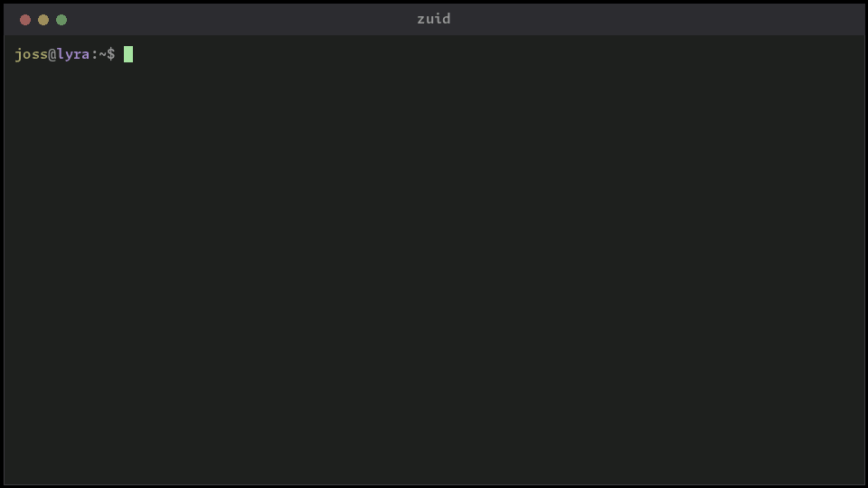

<!-- markdownlint-disable MD007 -- Unordered list indentation -->
<!-- markdownlint-disable MD010 -- No hard tabs -->
<!-- markdownlint-disable MD033 -- No inline html -->
<!-- markdownlint-disable MD055 -- Table pipe style [Expected: leading_and_trailing; Actual: leading_only; Missing trailing pipe] -->
<!-- markdownlint-disable MD041 -- First line in a file should be a top-level heading -->

<!--

-->

<!-- TOC ignore:true -->
# ZUID

Short, sortable, privacy-preserving unique identifiers - from a command line, a Go module, or a C module.

<!-- Video walkthrough: https://www.youtube.com/watch?v=REPLACE_ME -->

> **Alpha.** First prerelease is `v1.0.0-alpha.1`. Both implementations build and reproduce the shared test vectors, and every component works from the command line, the Go module, and the C module. It's for x86_64 Linux only, and it was built for newer CPUs than intended, so it stops with an illegal instruction on many Intel chips from before 2019. The next release fixes that and adds the other platforms. See [project/backlog.md](project/backlog.md) for where it stands.

<!-- TOC ignore:true -->
## Table of contents

<!-- TOC -->

- [Why](#why)
- [Features](#features)
- [How it is built](#how-it-is-built)
- [Installation](#installation)
- [Copyright and license](#copyright-and-license)

<!-- /TOC -->

## Why

A random UUID is 36 characters, sorts meaninglessly, and is awkward to read over a phone. Most of the time that buys uniqueness nobody needed.

An identifier built from a timestamp and rendered in a compact base is far shorter, sorts in creation order as plain text, and is still unique enough for the job. When it is not, more components can be mixed in - more time precision, host, user, hardware address, a UUID, or random data - and the same identifier gets as unique as required.

Host and user components are hashed by default, so an identifier does not leak where it came from. A hardware address (`%m`) is not hashed, so leave it out where that matters.

~~~console
$ zuid                          # the default: a timestamp, base 62, to the second
1wqd1q
$ zuid -f='%d%r'                # plus six random symbols, for same-second uniqueness
1wqd1wDppAd6
$ zuid -f='%d-%h-%u' -p='1'     # millisecond precision, with a hashed host and user
0VRArWn2-rw79Mr05-6UI3mO4y
$ zuid -f='%d%r' -n='3'         # three at once, one per line
1wqd2AKtvRnz
1wqd2AQ1mc6f
1wqd2A9xJbEY
~~~

Every component except an unhashed name is a fixed width, so identifiers line up in a column, sort as text, and can be split back into their parts by offset.

## Features

- Identifiers are as short as necessary, but no shorter.

- Sorts by creation time, as text, with no special comparison function.

- Uniqueness and length are yours to trade off.

- Batches in one run. `--count` prints as many as asked for, and says on stderr when the format made repeats.

- Private by default. Host and user are hashed unless asked otherwise, and `--salt` or `--salt-file` puts a secret of your own in front of the hash so candidate names cannot be tried against the output.

- A curated set of bases suited to identifiers, with the library's full set of seventy-odd still available.

- Embeddable, three ways:

	- A standalone command.

	- A permissively licensed Go module.

	- A C module, for nearly anything else. Also permissively licensed.

## How it is built

Base conversion is not reimplemented here. It comes from [convert-base-v2](https://github.com/jim-collier/convert-base-v2), so there is one definition of what a base means rather than two that can drift apart.

There are two implementations of the identifier spec, one in Go and one in Zig, and a shared table of test vectors that both have to reproduce. That is more work than one implementation with bindings around it, and it is deliberate: the two check each other, and neither is forced into the other's constraints.

The Go module stays free of cgo and cross-compiles statically. The Zig side produces the command and the C module. Full reasoning is in [project/design.md](project/design.md).

## Installation

See [install.md](install.md) for the packages, the install scripts, and building from source. To work on zuid itself, see [development.md](development.md).

## Copyright and license

The command is GPL-2.0-or-later. The Go and C modules are Apache-2.0, so embedding one brings no obligation beyond attribution. [license.md](license.md) says which license covers which directory, and links the full text of each.

> Copyright © 2026 Jim Collier [ID: 2უNაɘ«҂թȹɤξπ๙¿ձϖ] 
> Licensed under the [GNU General Public License v2.0 or later](https://spdx.org/licenses/GPL-2.0-or-later.html) 
> SPDX-License-Identifier: `GPL-2.0-or-later`  
> No warranty. 
> ZUID™ is a [trademark](trademark.md) of Jim Collier.
<!--
> Copyright © 2026 Jim Collier [ID: 2უNაɘ«҂թȹɤξπ๙¿ձϖ] 
> Copyright © 2026 t00mietum (CryptogID: ปʬϝღถɔ4რఠΔթะ9ƾǝu) 
> Copyright (c) 2026 Bubbles 

> Licensed under the [MIT License](https://mit-license.org/) 
> SPDX-License-Identifier: `MIT`. 
	- Most permissive and least protective

> Licensed under the [GNU General Public License v2.0](https://www.gnu.org/licenses/gpl-2.0.html).

> Licensed under the [GNU General Public License v2.0 or later](https://spdx.org/licenses/GPL-2.0-or-later.html).
> SPDX-License-Identifier: `GPL-2.0-or-later` 

> Licensed under the [GNU General Public License v3](https://www.gnu.org/licenses/gpl-3.0.en.html) license.

> Licensed under the [Mozilla Public License 2.0](https://mozilla.org/MPL/2.0/).

> Licensed under the [Apache 2.0 License](https://www.apache.org/licenses/LICENSE-2.0.html)
> SPDX-License-Identifier: `Apache-2.0` 
	- Permissive
	- Patent protection clause
	- Requires attribution
	- No contribute back
	- SaaS loophole
-->
